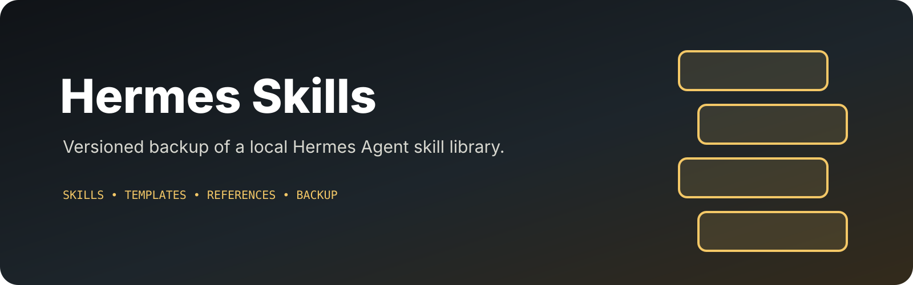

<p align="center">
  
</p>

# Hermes Skills

Backup of the local Hermes Agent skills collection at `~/.hermes/skills/`.

Captured: 2026-06-10 · 138 skills · 23MB

This is a personal backup, not a distribution channel. Skills are versioned
with the local Hermes install they were captured from and may reference
local paths, personal preferences, or machine-specific tooling.

## Layout

Each skill is a directory with a `SKILL.md` entry point (Agent Skills
standard). Many include `scripts/`, `references/`, `templates/`, and
`assets/` subdirectories.

## Origin

Skills come from three sources mixed together here:
- **Hub-installed** — protected from local edits, synced from the hub
- **Locally authored** — created or patched on this machine
- **Third-party** — installed via `third-party-skill-install`

## Restoring

This is a backup. To restore into a fresh Hermes install, copy the
contents of this repo to `~/.hermes/skills/`:

```bash
git clone https://github.com/benclawbot/hermes-skills.git ~/.hermes/skills
```

Note: hub-installed skills will be re-synced from the hub on next launch
and may overwrite restored copies — that's expected.

## License

Mixed. Each skill retains its own license (see its `SKILL.md` frontmatter).
